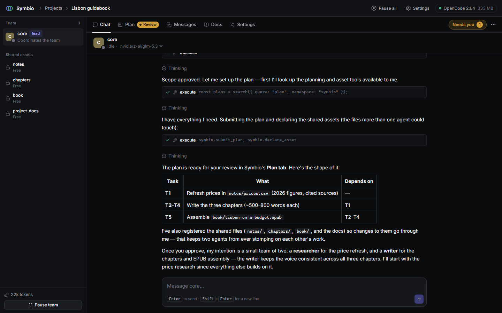
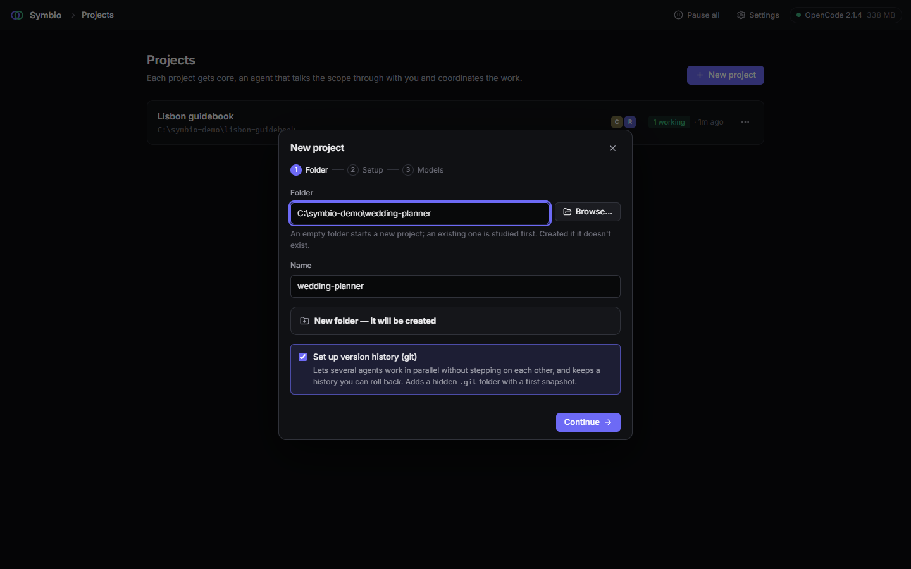
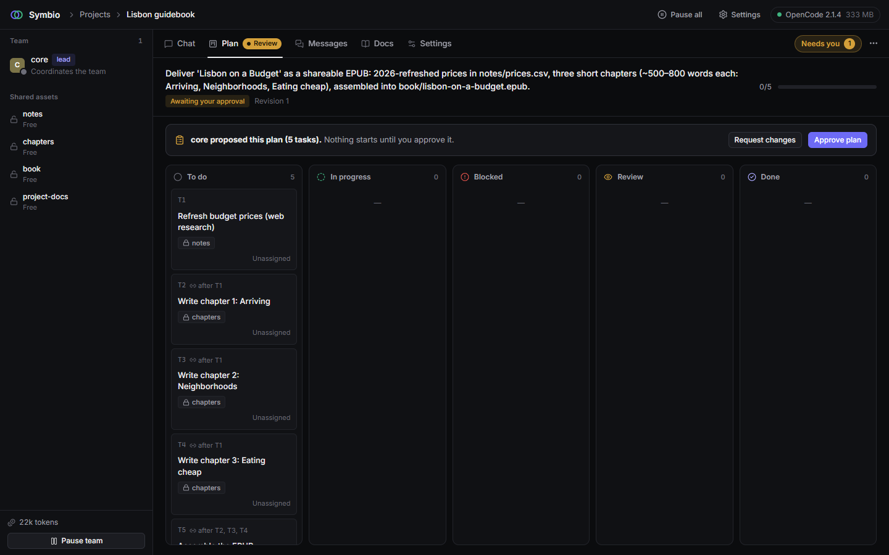
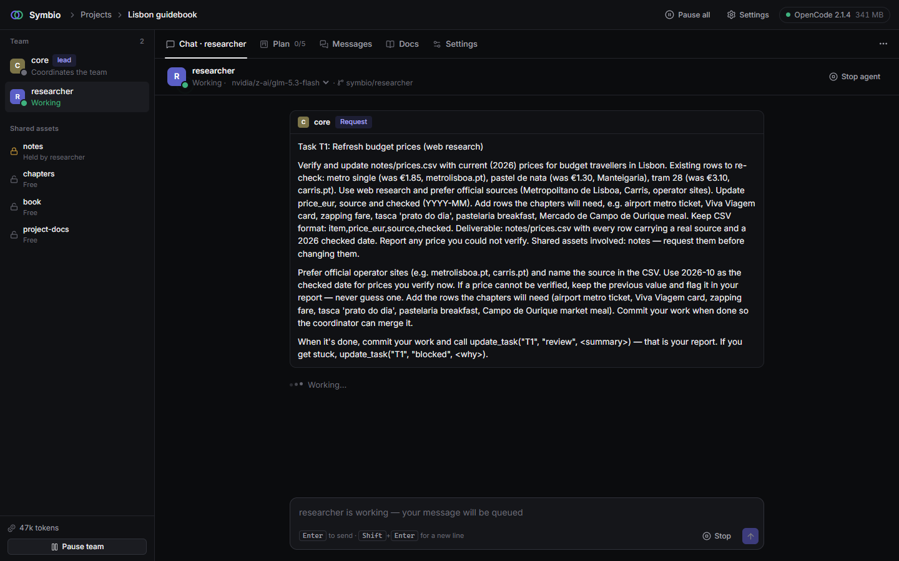
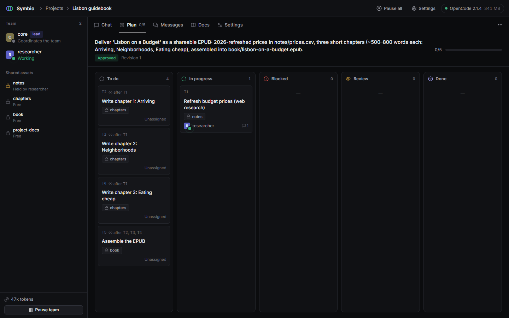
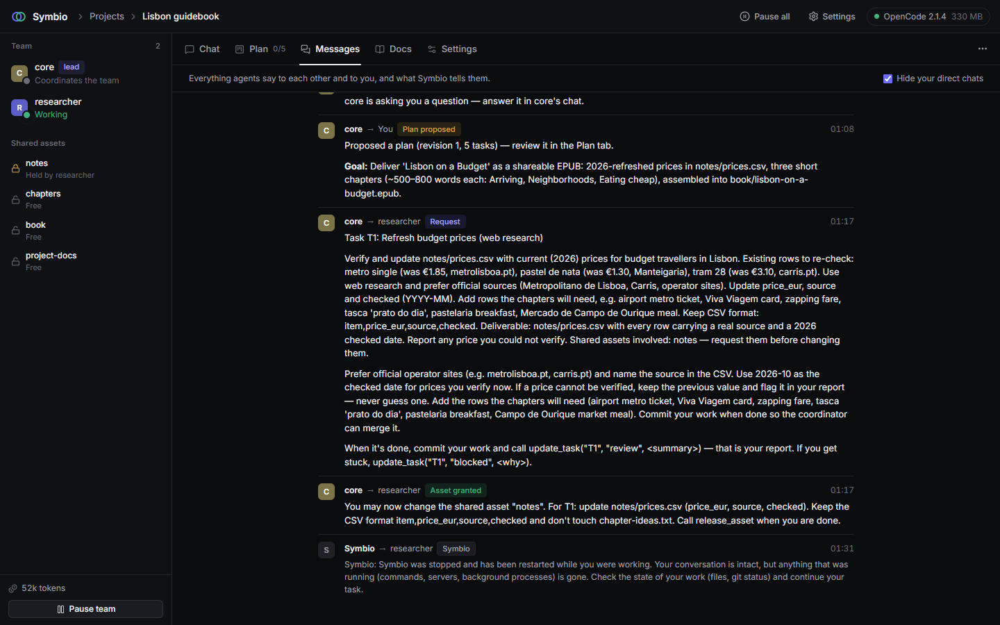

# Symbio

**Run a team of AI agents on your project, from your browser.**

Symbio is a local web app that coordinates several [OpenCode](https://opencode.ai) agents working on
the same folder. You talk to one lead agent, **core**. It works out the scope with you, proposes a
plan, and hands the work to helper agents, each in its own copy of the project. The agents message
each other directly, ask you when they need a decision, and you watch it all happen on a live board.

It isn't tied to software. A project is just a folder and a goal: code, a book, research, a data
cleanup, a set of documents. Symbio provides the machinery (messaging, isolation, coordination,
safety); the agents decide how to organize the work.



> **Built with AI.** Symbio was designed and written in collaboration with AI coding agents, and
> it's meant to be worked on the same way. The documentation for agents (and for humans who want the
> details) lives in [`docs/`](docs/README.md); [`AGENTS.md`](AGENTS.md) is the entry point for a coding
> agent opening this repository.

---

## A quick tour

These screenshots come from a real session. The project is a pocket travel guide, *Lisbon on a
Budget*, run on free models: the conversations, plan and messages were produced by the agents, not
mocked.

**1. Start from a folder.** Pick an empty folder for something new, or an existing one for core to
study first. Symbio can set up version history so helpers can work side by side; a folder that
holds several git repositories (say `client/` and `server/`) is kept as it is, and helpers work
inside each one.



**2. Approve the plan.** After asking a couple of questions, core proposes a plan with
dependencies and declares the shared assets. Nothing starts until you approve.



**3. core delegates.** It creates a helper for the first task and gives it a precise brief. The
helper works on its own branch; the shared `notes` folder is held by it until it's done.



**4. Follow the work.** The board moves by itself as helpers pick up, finish and hand in tasks.



**5. See every message.** Requests, asset grants, plan updates and Symbio's own notices, all in one
place. Here Symbio was restarted mid-task, and it told the helper to pick up where it left off.



## What it does

- **One conversation, a whole team.** You chat with core. It asks what you want, studies an
  existing folder before touching it, and proposes a plan of tasks for you to approve.
- **Helpers that work in parallel without collisions.** Each helper gets its own git worktree and
  branch, and core reviews and merges their work. For step-by-step work (each step using the
  previous one's files), helpers can share the project folder instead, with nothing to merge.
  Helpers are only created when work can really run in parallel; one helper is the default.
- **Agents talk to each other.** Messages go straight from agent to agent through Symbio, and
  delivering a message wakes the recipient. No copy-pasting between terminals.
- **Shared assets with a gatekeeper.** Anything several agents could change (a file pattern, a
  database, a spreadsheet) can be declared a *shared asset*. Agents request it from core, wait for
  the grant and release it when done. Changes to an asset an agent wasn't granted are flagged at
  merge.
- **Review the work your way.** Helpers report each finished task with a guide for checking it:
  where to look, the steps and what you should see. Let core review (the default), or review every
  task yourself from a "To review" list (approve it, or send it back with a note to the helper), or
  only the tasks marked in the plan. Each task's changed files and diffs are a click away.
- **Questions in one list, not lost in the chat.** When the team needs a decision from you, it goes
  to your open questions (numbered, with context and suggested answers). Answer several at once
  when you have a moment; each agent gets its answers, and the same question isn't asked twice.
- **Choose how core takes your message.** A selector in the chat box: *Auto* (core decides),
  *Plan* (discuss and plan only: Symbio blocks starting work and editing files until you switch)
  or *Act* (get it done without a plan to approve).
- **Attach files to a message.** Upload, drag in or paste images and documents into the chat, as in
  other AI chats. Agents get them as files they can open (images as scaled-down copies, PDF, Word,
  Excel and PowerPoint as text), and each project's **Files** tab keeps everything sent, to open,
  resend or delete.
- **Documentation you can find your way in.** core keeps the project's docs up to date, and the
  Docs tab shows them as a folder tree with search across every doc, links between docs that open
  in place, an outline of long docs, and plain-text sources (e-mails, transcripts) with line
  numbers.
- **A rules register (optional).** Agents record the project's rules (requirements, decisions,
  constraints) with where each came from, a literal excerpt, who imposes it, how confirmed it is
  and whether it's met. The Docs tab shows them as an index you can filter and search, with each
  citation opening its source at the cited line.
- **A live plan.** The Plan tab is an animated kanban that moves by itself as helpers pick up
  tasks, ask for review and get merged.
- **You stay in control.** Questions, plan approvals, permission requests (like installing
  software) and deploy approvals collect in a **Needs you** inbox. Pause one team or everything at
  once.
- **Connections without exposing secrets.** Give agents a GitHub account, an Azure DevOps
  organization, a server (SSH, SFTP) or an FTP account. They ask Symbio to push, open pull requests, call the API or deploy, and Symbio does it with credentials the agents never
  see. Each connection can require your approval for every action.
- **Resilient.** A supervisor restarts OpenCode if it crashes, a watchdog unsticks hung agents, and
  when a model fails (quota, outage) the agent switches to the next allowed model and carries on.
- **Long-running teams stay healthy.** Agents can continue in a fresh session with a handoff note
  (when you ask, after each finished task, or automatically when a conversation grows too large to
  send). A daily check backs up Symbio's state and tells you and core about work that exists only
  on this machine and build outputs filling the disk.
- **Costs in view.** Tokens and estimated cost per agent and model, with prices you can set.
- **Safety rails.** Agents can't kill processes by name (which would take down your terminals and
  editors), can't read your SSH keys or Symbio's secret store, and must ask before installing
  software. They look at images through scaled-down copies, so a few large pictures can't make a
  conversation too big to send.

## Requirements

- **Node.js 22+**
- **Git** (recommended): it isolates helpers from each other. Without git, helpers share the folder
  and rely on shared-asset grants alone.
- A model provider: OpenCode's own, or any you connect in Symbio's **Settings → Model providers**
  (API key or browser sign-in).

Symbio brings its own copy of [OpenCode](https://opencode.ai), pinned to a version it's tested
with, and runs it privately. It shares your OpenCode configuration and provider logins, so
providers you already use in OpenCode show up in Symbio too.

Symbio has been developed and used on **Windows 11**. It's written to be cross-platform (macOS and
Linux are expected to work), but those haven't been tested yet. Reports are welcome.

## Getting started

```sh
npm install -g symbio
sym                  # starts Symbio in the background and opens it in your browser
```

Symbio opens its page with a private key in the link (it also prints the link). The browser
remembers the key, so after that `http://127.0.0.1:4310` is enough. The key stops other programs
on your computer, including the agents, from using Symbio's API behind your back.

| Command | |
|---|---|
| `sym` | Start Symbio in the background and open it (or just open it, if it's running). Closing the terminal doesn't stop it. |
| `sym stop` | Stop Symbio. Agents that were working pick up where they left off on the next start. |
| `sym status` | Whether it's running, OpenCode's state, and each project's agents. |
| `sym open` | Open Symbio in the browser. |
| `sym logs` | The last lines of the log (`~/.symbio/logs/symbio.log`). |
| `sym doctor` | Check Node.js, git, OpenCode, the port and model providers. |
| `sym run` | Run in the foreground, with the log in the terminal. |
| `sym remote` | Open a temporary link and access code to use Symbio from another device (see below). `sym remote off` closes it. |
| `sym update` | Install the latest version and restart Symbio, once no agent is working (`--now` doesn't wait). |
| `sym update --to 0.9.0` | Install that version instead, e.g. to go back after a release that broke something; automatic updates then skip the version you left and resume with the next release. |

**Updates.** Symbio checks for new versions and, by default, installs them by itself while the team
is idle: never while an agent is working or waiting for you, or while remote access is on. It backs
up first, restarts in a minute or two, and tells you in Messages. In Settings → Updates you can
choose to be only told instead, or turn checking off, and see what's new. If a release breaks
something, `sym update --to <version>` goes back to the one before.

**From another device.** `sym remote` opens a temporary Cloudflare link to your Symbio and prints it
with an access code. Open the link anywhere (phone, another computer), enter the code, and you're
in. A banner shows it's on, with a button to turn it off; after 10 wrong codes it turns off by
itself. Whoever gets in controls your agents, so keep the link and code to yourself. Details in
[docs/security.md](docs/security.md#remote-access-optional).

`symbio` works too, as the long name of `sym`. To run from a clone instead: `npm install`,
`npm run build`, then `npm link` once to get the commands.

## How to use it

1. **Connect your models.** Open **Settings → Model providers** and check that the providers you
   use are there. Add one with an API key or a browser sign-in, and remove the ones you don't use
   so the model list stays short.
2. **Create a project.** On the Projects page, click **New project**:
   - **Folder:** browse for or paste a folder. An empty folder starts a new project; an existing
     one is studied first. Symbio offers to set up git if the folder doesn't have it.
   - **Setup:** choose where the project documentation goes (in the project, or private), and which
     connections (GitHub, Azure DevOps, servers) the agents may use.
   - **Models:** pick the models agents may use, and the one core runs on (the crown).
3. **Talk to core.** Describe what you want. core asks questions, proposes a plan, and waits for
   your approval in the **Plan** tab (it shows a *Review* badge).
4. **Watch and steer.** Helpers appear in the sidebar as core creates them. Click any agent to read
   its conversation or message it directly, change its model from its header, or stop and restart
   it. The **Messages** tab shows all traffic between agents.
5. **Answer what needs you.** Questions, approvals and permission requests show up in **Needs you**
   (top right) and in the relevant chat.

### Words used in the app

| Term | Meaning |
|---|---|
| **core** | The project's lead agent. It plans, delegates, reviews and merges; it coordinates rather than doing the work itself. |
| **Helper** | An agent core creates for a piece of work. It works in its own git worktree (branch `symbio/<name>`) or, if the project is set to, in the project folder itself. |
| **Shared asset** | Something more than one agent could change. Access goes through core: request, grant, release. |
| **Connection** | A GitHub account, Azure DevOps organization, server (SSH, SFTP) or FTP account agents can use through Symbio, without ever seeing its credentials. |
| **Allowed models** | The models a project's agents may run on. If one fails, agents fall back to the next. Some can be kept for core only, and core can be limited to some. |

## Where your data lives

| Location | What |
|---|---|
| `~/.symbio/config.json` | The list of projects |
| `~/.symbio/connections.json` | Connection settings (no secrets) |
| `~/.symbio/secrets.enc` | Connection secrets, encrypted with a key kept in your OS credential store |
| `~/.symbio/worktrees/` | Helpers' working copies |
| `~/.symbio/backups/` | Daily backups of Symbio's state (the last 7 days) |
| `~/.symbio/approvals/` | Remote actions waiting for (or decided by) your approval |
| `~/.symbio/prices.json` | Model prices used for cost estimates |
| `~/.symbio/ui-token` | The key that unlocks the UI (it's in the link Symbio opens) |
| `~/.symbio/logs/symbio.log` | Symbio's log when started in the background (`sym logs`); `update.log` next to it for updates |
| `~/.symbio/updates.json` | Your update setting (automatic, tell me, off) |
| `<project>/.symbio/` | Project state: agents, plan, message log, shared assets, and the files attached in chats (`attachments/`) — git-ignored automatically |
| `<project>/AGENTS.md`, `<project>/docs/` | Project documentation for agents (unless you chose *private*), and `docs/rules.json` if the rules register is on |
| OpenCode's database | The conversations themselves. Every agent is an OpenCode session, so you can also open one with `opencode -s <session-id>`. |

Symbio never deletes your project files. Removing a project from Symbio only forgets it, and can
optionally delete its `.symbio/` folder.

## Configuration

All optional, set as environment variables:

| Variable | Default | Purpose |
|---|---|---|
| `SYMBIO_PORT` | `4310` | Port for the UI and API (bound to 127.0.0.1 only) |
| `SYMBIO_HOME` | `~/.symbio` | Where Symbio keeps its global data |
| `SYMBIO_NO_OPEN` | | Set to `1` to not open the browser on start (use the link Symbio prints) |
| `SYMBIO_DEBUG` | | Set to `1` to enable the read-only OpenCode debug routes (for development) |
| `SYMBIO_OPENCODE_BIN` | bundled | Path to an `opencode` executable to use instead of the bundled one |
| `SYMBIO_CLOUDFLARED_BIN` | auto | Path to `cloudflared` for remote access (otherwise the PATH, or a copy downloaded once) |
| `SYMBIO_STUCK_MINUTES` | `10` | Silence before the watchdog interrupts a working agent |
| `SYMBIO_RECYCLE_MB` | `1500` | Restart OpenCode above this memory use once every agent is idle |
| `SYMBIO_RECYCLE_HARD_MB` | `3000` | Restart OpenCode above this memory use regardless (agents resume) |
| `SYMBIO_MEMORY_CHECK_SECONDS` | `60` | How often OpenCode's memory use is checked |
| `SYMBIO_BACKUP_DAYS` | `7` | How many daily backups of Symbio's state to keep |
| `SYMBIO_BUILD_ALERT_GB` | `2` | Build outputs in a helper's folder above this size are reported by the daily check |

## Status

Symbio is young and changing quickly, shaped by people using it for real work. The core workflow
works end to end: projects, core and helpers, messaging, plan and kanban, shared assets, docs and
the rules register, connections (GitHub, Azure DevOps, servers), providers, costs and recovery.
What's planned and what's open for help is in [docs/roadmap.md](docs/roadmap.md); what changed in
each version is in [CHANGELOG.md](CHANGELOG.md).

## Documentation

- [docs/](docs/README.md): architecture, the agent protocol, the OpenCode API notes, development
  and security. Written for both people and coding agents.
- [AGENTS.md](AGENTS.md): the short entry point for an AI agent working on this repository.
- [CONTRIBUTING.md](CONTRIBUTING.md): how to set up, make changes and open a pull request.
- [SECURITY.md](SECURITY.md): how to report a vulnerability.

## Contributing

Contributions are welcome, whether you write the code yourself or with an AI agent. Start with
[CONTRIBUTING.md](CONTRIBUTING.md).

## License

[MIT](LICENSE) © LinKzy
