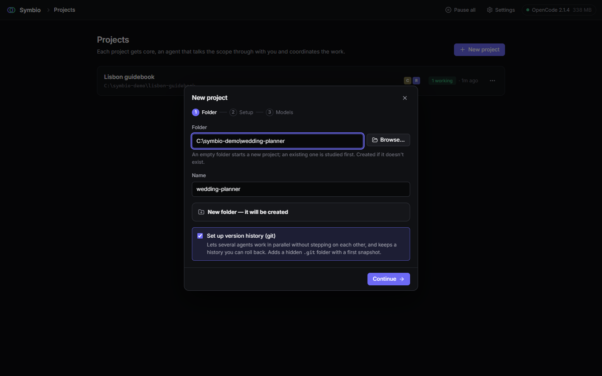
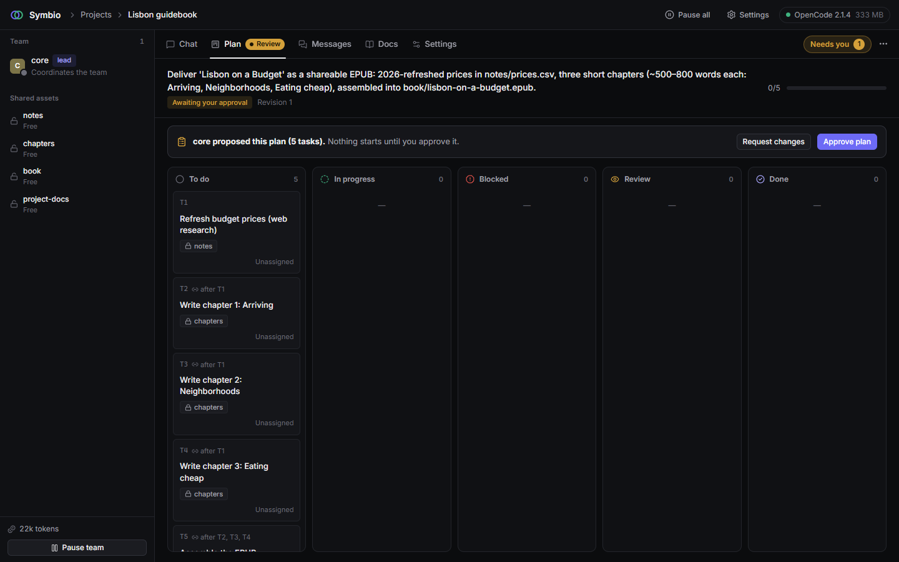
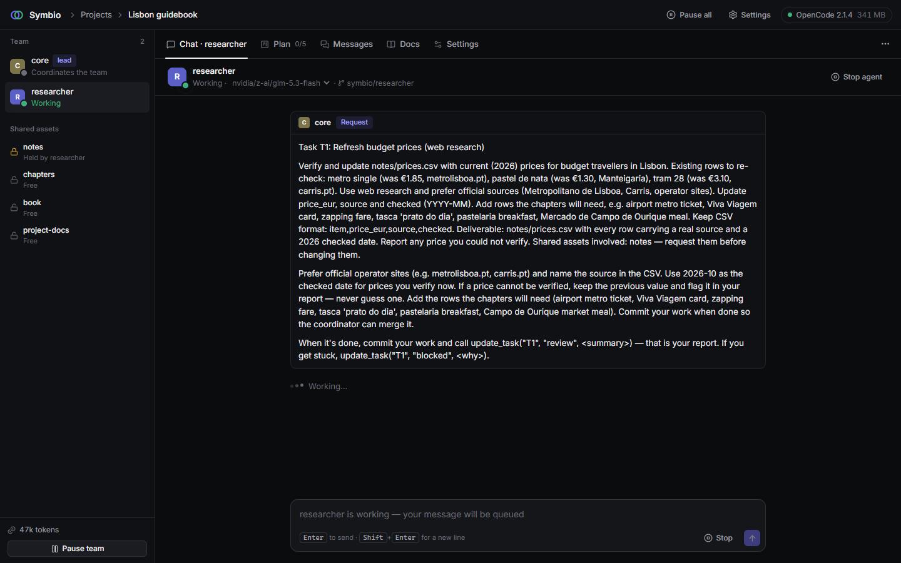
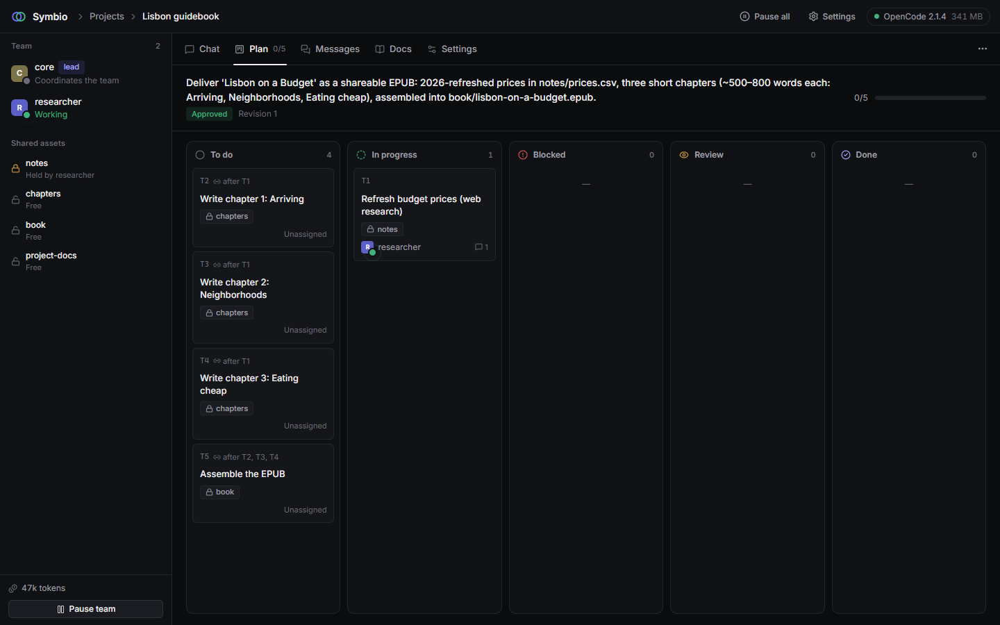
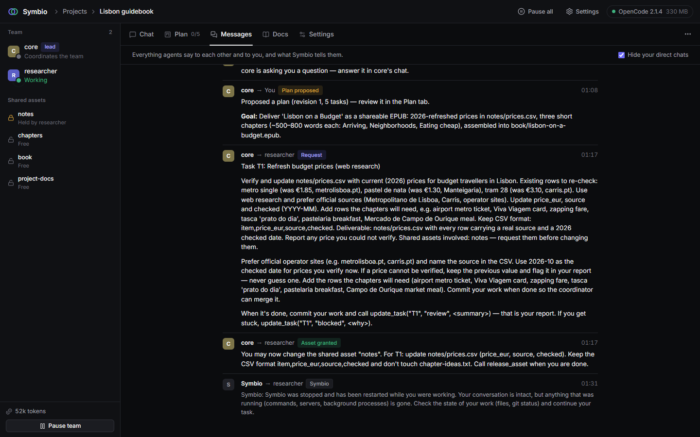
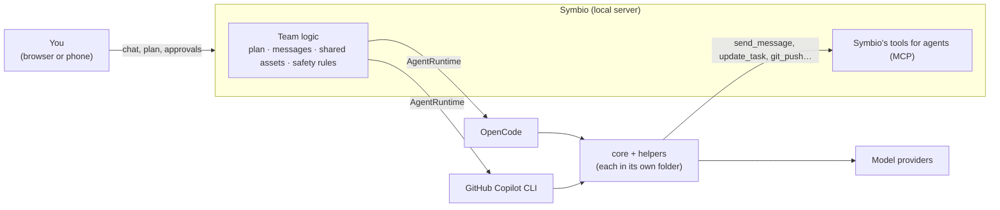

# Symbio

[](https://github.com/linkzy/symbio/actions/workflows/ci.yml)
[](https://www.npmjs.com/package/symbio)
[](LICENSE)
[](https://github.com/linkzy/symbio/issues?q=is%3Aissue+is%3Aopen+label%3A%22good+first+issue%22)
[](https://github.com/linkzy/symbio/discussions)

**Run a team of AI agents on your project, from your browser.** · [symbio.linkzy.dev](https://symbio.linkzy.dev)

Symbio is a local web app that coordinates several AI agents working on the same folder. You talk
to one lead agent, **core**. It works out the scope with you, proposes a plan, and hands the work
to helper agents, each in its own copy of the project. The agents message
each other directly, ask you when they need a decision, and you watch it all happen on a live board.

It isn't tied to software. A project is just a folder and a goal: code, a book, research, a data
cleanup, a set of documents. Symbio provides the machinery (messaging, isolation, coordination,
safety); the agents decide how to organize the work.

It isn't tied to one AI tool either. The agents run on an **agent runtime** you choose per project:
[OpenCode](https://opencode.ai), with the model providers you connect (OpenAI, Anthropic, Azure,
OpenRouter, local models…), or **GitHub Copilot CLI** (preview), with your Copilot subscription. You
install only the ones you use, and a project can move from one to the other.


*A real session, sped up: a pocket guide to Porto written by core and four helpers on GitHub Copilot
CLI with Claude Haiku 5.5 (about 9 million tokens, mostly cached: roughly $0.20).*

> **Built with AI.** Symbio was designed and written in collaboration with AI coding agents, and
> it's meant to be worked on the same way. The documentation for agents (and for humans who want the
> details) lives in [`docs/`](docs/README.md); [`AGENTS.md`](AGENTS.md) is the entry point for a coding
> agent opening this repository.

---

## Why Symbio

One AI agent in one terminal is easy. A real project with several agents is not: someone has to
split the work, keep two agents from editing the same thing, pass results along, notice when one is
stuck, and ask you when a decision is needed. Doing that by hand means copy-pasting between
terminals all day.

Symbio does that part. It started as a way to run real projects (a .NET system worked on by twenty
helpers, research, documentation) with a team of agents, and grew into a tool for any project with
a goal and a folder.

## Quick start

```sh
npm install -g symbio
sym
```

Symbio opens in your browser. The first time, install an agent runtime from the Projects page
(OpenCode or GitHub Copilot CLI), then click **New project** and tell core what you want. Node.js 22+
is required, and git is recommended. All the commands, updates and remote access are in
[docs/usage.md](docs/usage.md).

## A quick tour

These screenshots come from a real session. The project is a pocket travel guide, *Lisbon on a
Budget*, run on free models: the conversations, plan and messages were produced by the agents, not
mocked.

**1. Start from a folder.** Pick an empty folder for something new, or an existing one for core to
study first. Symbio can set up version history so helpers can work side by side; a folder that
holds several git repositories (say `client/` and `server/`) is kept as it is, and helpers work
inside each one.



**2. Approve the plan.** After asking a couple of questions, core proposes a plan with
dependencies and declares the shared assets. Here nothing starts until you approve; if you'd rather
it ran on its own, a project setting lets core decide, start, and tell you what it decided.



**3. core delegates.** It creates a helper for the first task and gives it a precise brief. The
helper works on its own branch; the shared `notes` folder is held by it until it's done.



**4. Follow the work.** The board moves by itself as helpers pick up, finish and hand in tasks.



**5. See every message.** Requests, asset grants, plan updates and Symbio's own notices, all in one
place. Here Symbio was restarted mid-task, and it told the helper to pick up where it left off.



**6. Answer when the team needs you.** Decisions come to you as questions, with context and
suggested answers (here from the Porto guide in the animation above). Answer when you have a
moment; the agent that asked carries on.


## What it does

- **A whole team from one conversation.** You talk to core; it plans with you, creates helpers, and
  reviews and merges their work. Helpers work in parallel in their own git copies, or one after
  another in the project folder.
- **Runs on its own, or asks: your choice.** Per project, core either decides what it can undo and
  tells you (decisions you keep or change later), or asks you and waits. You write what the team
  may do without asking (spending, deploying, deleting…).
- **Quality without babysitting.** Every task has a *Done when*. Checks you approve (a build, tests,
  a spellcheck…) run on each finished task, a separate reviewer can check the work, and anything
  that fails goes back to the helper before it reaches you. A project glossary keeps everyone using
  the same words.
- **Skills.** A library of methods agents load when a task calls for one (planning, software,
  design, writing, data, operations, media), Symbio's own and popular ones by other authors; core
  gives each helper the ones its work needs.
- **Agents talk to each other** through Symbio, and shared assets (files, a database, a
  spreadsheet) go to one agent at a time, granted by core.
- **You stay in control.** Questions (or core's questions about a feature, grouped in a briefing),
  decisions, permission requests and deploy approvals collect in **Needs you**; you can review every
  task yourself or let core do it.
- **Your choice of runtime and models.** OpenCode or GitHub Copilot CLI per project, with any model
  they offer; move a project from one to the other; pin an agent to its model; set reasoning effort.
- **Connections without exposing secrets.** Agents push to GitHub, call Azure DevOps or deploy over
  SSH/FTP through Symbio, which holds the credentials and can ask you before each action.
- **Built for long-running work.** Crash recovery, a watchdog, model fallback, fresh sessions with
  handoff notes, daily backups, self-updates, and a machine view that shows who started each program
  and keeps small computers usable.
- **A UI to live in.** Live kanban, docs with search, an Explorer, files tagged by task, costs per agent and model,
  themes (including VS Code's), an editor-like *Workbench* layout, English or Portuguese, and a phone
  layout with remote access.

Every feature in detail: [docs/features.md](docs/features.md).

## How it works



Symbio is a Node.js server with a React UI, bound to your computer only. Each agent is a session of
an agent runtime, and Symbio talks to every runtime through one interface. Agents call back into
Symbio through its tools, and Symbio checks every action against its safety rules. The details are
in [docs/architecture.md](docs/architecture.md).

## Engineering highlights

- **One interface, two runtimes.** The team logic only knows `AgentRuntime`. The Copilot adapter
  translates the Copilot SDK's events into the same vocabulary as OpenCode's, so plans, messages,
  rules and the UI are identical on both.
- **Every end-to-end test runs on both runtimes.** Browser tests (Playwright) drive the real app
  against stand-in runtimes that script the agents, so they need no API key and run in CI on every
  pull request. Contract tests check the real OpenCode and Copilot CLI APIs Symbio relies on.
- **Gated releases.** Pushing a version tag runs typecheck, unit, contract and end-to-end tests,
  then publishes to npm with provenance and writes the GitHub release.
- **Safety by default.** Every tool call is checked against rules (no killing processes by name, no
  reading keys or Symbio's secrets, no changing Symbio's own settings, ask before installing).
  Credentials stay on the server, encrypted with a key from the OS credential store, and the UI
  and API need a per-install key.
- **Isolation through git.** Helpers work in their own worktrees, and merges are checked against the
  shared assets each helper was granted.
- **Self-healing.** A supervisor restarts crashed runtimes, a watchdog unsticks hung agents, models
  fall back or are retried, memory is recycled, and updates back up first and can be rolled back.
- **Built with AI, held to a standard.** Most of the code was written with AI coding agents,
  following [AGENTS.md](AGENTS.md): verify runtime behavior live, test on both runtimes, keep the
  docs true.

## Limitations

An honest list; see [docs/known-issues.md](docs/known-issues.md) for details and open problems.

| | |
|---|---|
| **Platforms** | Developed and used on Windows 11. macOS and Linux should work but haven't been tested. |
| **Isolation** | Agents run as your user. The safety rules are pattern checks, not a sandbox. |
| **Resource limits** | Agents' programs run at low priority, but there's no hard CPU or memory cap. |
| **One person** | No accounts or sharing; remote access lets you, not others, use it from another device. |
| **GitHub Copilot CLI** | In preview: it relies on the Copilot SDK, which is new. |
| **Conversations** | They live in the runtime's storage on this computer; a project moved to another machine keeps its docs and plan, not its agents' sessions. |
| **Languages** | English and Portuguese (Brazil), the browser's language by default; Spanish, French and German in progress. |

## FAQ

**Does it cost anything?**
Symbio is free and open source (MIT). The models are what cost: your provider's prices or your
Copilot subscription (OpenCode also offers some free models). Symbio shows the estimated cost per
agent and model.

**Is it only for code?**
No. A project is a folder and a goal: a book, research, documents, a data cleanup. Symbio's
machinery (plan, messages, shared assets, reviews) works the same for any of them.

**Is it safe to let agents work on my computer?**
Agents can run commands as your user, like any coding agent. Symbio adds rules on top (see
[docs/security.md](docs/security.md)) and asks you before installs and remote actions, but it isn't
a sandbox. Start with a test folder and read what's allowed.

**Does Symbio send my data anywhere?**
Your conversations go to the model provider you chose, through the agent runtime. Symbio itself
only contacts its update endpoint (`symbio.linkzy.dev/update`, which says the latest version), or
npm when that doesn't answer, and GitHub to read release notes. The update check carries Symbio's
version and an **anonymous install id** (a random number), so we can tell how many people use
Symbio and whether they keep using it; nothing about your projects or your computer, and you can
turn it off in Settings → This computer → Updates (details in [security.md](docs/security.md#update-checks)).
Remote access goes through Cloudflare only while you have it on. Notifications go only to the
channels you turn on (Telegram, ntfy, a webhook, your e-mail server), and can say only "a project
needs you".

**Do I need git?**
It's recommended: helpers then work in parallel in their own copies. Without git they share the
project folder, coordinated by shared-asset grants. If git isn't installed, the New project dialog
says so where you'd turn it on, and on Windows can install it for you.

**Can I use it from my phone?**
Yes: `sym remote` gives you a temporary link and access code, and the interface adapts to small
screens.

**Where do I report a bug or ask a question?**
The **Report a problem** button in Symbio opens a bug report with your versions filled in.
Questions and ideas go to [Discussions](https://github.com/linkzy/symbio/discussions), and security
problems privately, per [SECURITY.md](SECURITY.md).

## Documentation

| | |
|---|---|
| [docs/usage.md](docs/usage.md) | Installing, the `sym` commands, updates, remote access, your first project |
| [docs/features.md](docs/features.md) | Every feature in detail |
| [docs/configuration.md](docs/configuration.md) | Environment variables and where your data lives |
| [docs/known-issues.md](docs/known-issues.md) | Known issues and limitations |
| [docs/roadmap.md](docs/roadmap.md) and [CHANGELOG.md](CHANGELOG.md) | What's next, and what changed in each version |
| [docs/](docs/README.md) | For contributors and coding agents: architecture, the agent protocol, the runtimes' APIs, development, security, releasing |

## Contributing

Contributions are welcome, whether you write the code yourself or with an AI agent (the repository
has an [AGENTS.md](AGENTS.md) for them). Start with [CONTRIBUTING.md](CONTRIBUTING.md). Every roadmap
item has an issue; say there that you're taking it.

Small, self-contained [good first issues](https://github.com/linkzy/symbio/issues?q=is%3Aissue+is%3Aopen+label%3A%22good+first+issue%22)
are waiting, for example find in a chat (#28), keyboard shortcuts (#29), exporting a chat as
Markdown (#31), filters for a project's skills (#60) and an accessibility pass (#33). Bigger ones are labelled
[help wanted](https://github.com/linkzy/symbio/issues?q=is%3Aissue+is%3Aopen+label%3A%22help+wanted%22).

## Contributors

Thanks to everyone who has contributed to Symbio:

- Ismail Duran: usage by provider and model (#15), Give feedback (#17) and Report a problem (#16).
- [Wesley Pereira (@wesleyhjpr)](https://github.com/wesleyhjpr): using an OpenCode already on your
  computer (#36) and the interface in Portuguese (Brazil) (#37).
- [Veeramanikandan R (@Veeramanikandanr48)](https://github.com/Veeramanikandanr48): copy buttons in the chat (#42).
- [TariQMah (@TariQMah)](https://github.com/TariQMah): copying and sharing the remote access link and code together (#64).

Symbio ships a few skills by other authors, each credited in Settings → Skills with its license:
[Matt Pocock](https://github.com/mattpocock/skills), [Jesse Vincent](https://github.com/obra/superpowers),
[Anthropic](https://github.com/anthropics/skills), [Addy Osmani](https://github.com/addyosmani/agent-skills),
[GitHub](https://github.com/github/awesome-copilot), [Siqi Chen](https://github.com/blader/humanizer) and
[Corey Haines](https://github.com/coreyhaines31/marketingskills) (details in `skills/catalog.json`).

<a href="https://github.com/linkzy" title="linkzy"></a>
<a href="https://github.com/wesleyhjpr" title="wesleyhjpr"></a>
<a href="https://github.com/Veeramanikandanr48" title="Veeramanikandanr48"></a>
<a href="https://github.com/TariQMah" title="TariQMah"></a>

[All contributors on GitHub](https://github.com/linkzy/symbio/graphs/contributors).

## License

[MIT](LICENSE) © LinKzy
