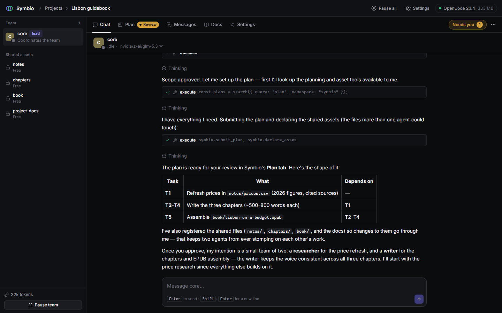
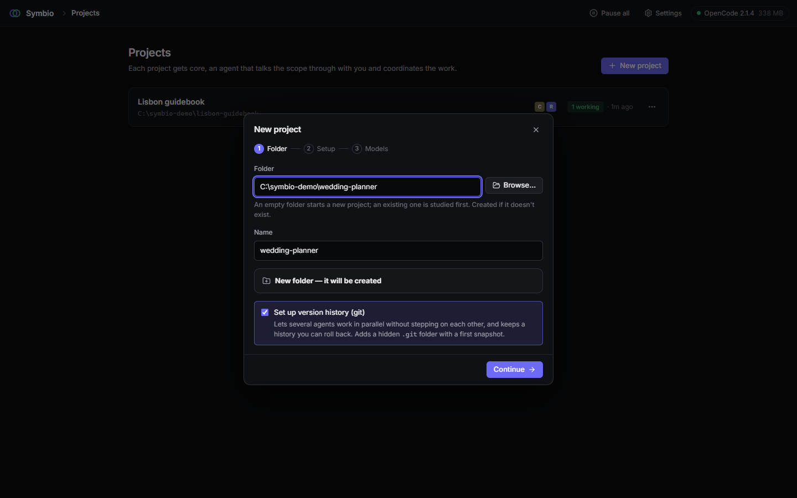
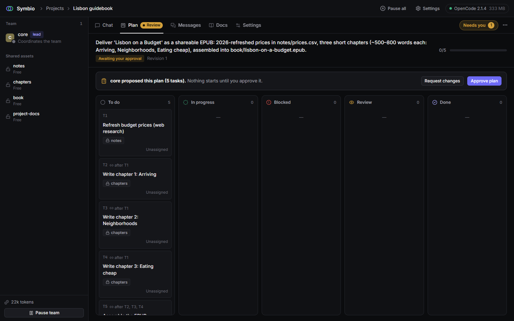
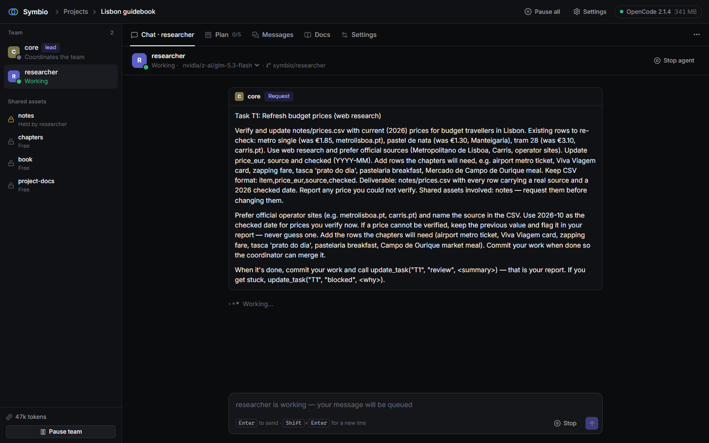
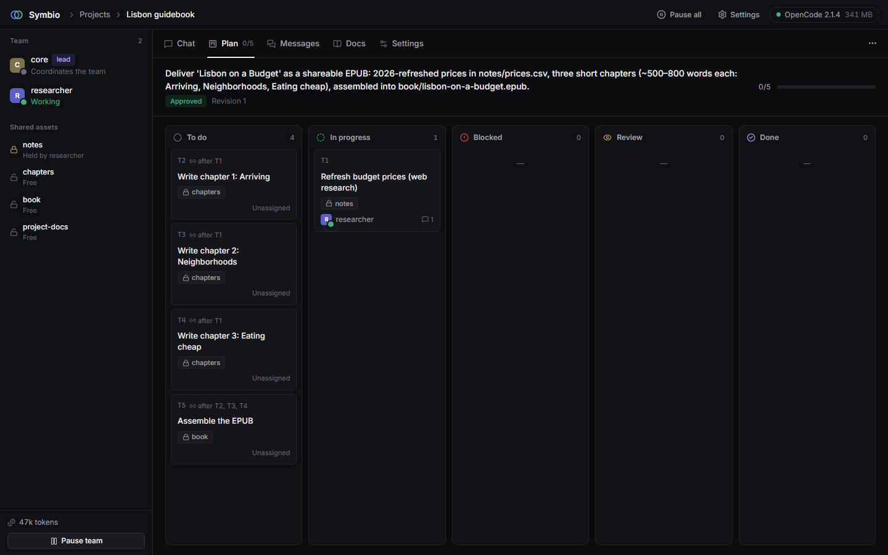
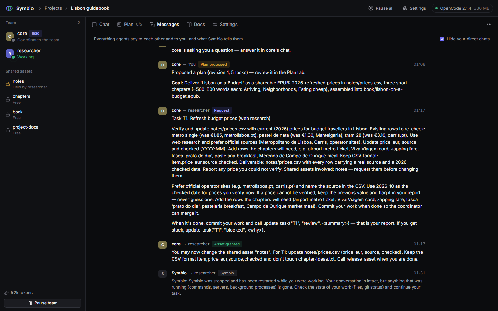

# Symbio

**Run a team of AI agents on your project, from your browser.**

Symbio is a local web app that coordinates several [OpenCode](https://opencode.ai) agents working on
the same folder. You talk to one lead agent, **core**. It works out the scope with you, proposes a
plan, and hands the work to helper agents, each in its own copy of the project. The agents message
each other directly, ask you when they need a decision, and you watch it all happen on a live board.

It isn't tied to software. A project is just a folder and a goal: code, a book, research, a data
cleanup, a set of documents. Symbio provides the machinery (messaging, isolation, coordination,
safety); the agents decide how to organize the work.



> **Built with AI.** Symbio was designed and written in collaboration with AI coding agents, and
> it's meant to be worked on the same way. The documentation for agents (and for humans who want the
> details) lives in [`docs/`](docs/README.md); [`AGENTS.md`](AGENTS.md) is the entry point for a coding
> agent opening this repository.

---

## A quick tour

These screenshots come from a real session. The project is a pocket travel guide, *Lisbon on a
Budget*, run on free models: the conversations, plan and messages were produced by the agents, not
mocked.

**1. Start from a folder.** Pick an empty folder for something new, or an existing one for core to
study first. Symbio can set up version history so helpers can work side by side.



**2. Approve the plan.** After asking a couple of questions, core proposes a plan with
dependencies and declares the shared assets. Nothing starts until you approve.



**3. core delegates.** It creates a helper for the first task and gives it a precise brief. The
helper works on its own branch; the shared `notes` folder is held by it until it's done.



**4. Follow the work.** The board moves by itself as helpers pick up, finish and hand in tasks.



**5. See every message.** Requests, asset grants, plan updates and Symbio's own notices, all in one
place. Here Symbio was restarted mid-task, and it told the helper to pick up where it left off.



## What it does

- **One conversation, a whole team.** You chat with core. It asks what you want, studies an
  existing folder before touching it, and proposes a plan of tasks for you to approve.
- **Helpers that work in parallel without collisions.** Each helper gets its own git worktree and
  branch. core reviews and merges their work. Helpers are only created when work can really run in
  parallel; one helper is the default.
- **Agents talk to each other.** Messages go straight from agent to agent through Symbio, and
  delivering a message wakes the recipient. No copy-pasting between terminals.
- **Shared assets with a gatekeeper.** Anything several agents could change (a file pattern, a
  database, a spreadsheet) can be declared a *shared asset*. Agents request it from core, wait for
  the grant and release it when done. Changes to an asset an agent wasn't granted are flagged at
  merge.
- **A live plan.** The Plan tab is an animated kanban that moves by itself as helpers pick up
  tasks, ask for review and get merged.
- **You stay in control.** Questions, plan approvals, permission requests (like installing
  software) and deploy approvals collect in a **Needs you** inbox. Pause one team or everything at
  once.
- **Connections without exposing secrets.** Give agents a GitHub account or an SSH server. They
  ask Symbio to push, call the API or deploy, and Symbio does it with credentials the agents never
  see. Each connection can require your approval for every action.
- **Resilient.** A supervisor restarts OpenCode if it crashes, a watchdog unsticks hung agents, and
  when a model fails (quota, outage) the agent switches to the next allowed model and carries on.
- **Safety rails.** Agents can't kill processes by name (which would take down your terminals and
  editors), can't read your SSH keys or Symbio's secret store, and must ask before installing
  software.

## Requirements

- **Node.js 22+**
- **OpenCode 2.x:** `npm i -g @opencode/cli`. Symbio starts its own private OpenCode server, using
  your normal OpenCode configuration and provider logins.
- **Git** (recommended): it isolates helpers from each other. Without git, helpers share the folder
  and rely on shared-asset grants alone.
- At least one model provider connected in OpenCode. You can add providers from Symbio's Settings.

Symbio has been developed and used on **Windows 11**. It's written to be cross-platform (macOS and
Linux are expected to work), but those haven't been tested yet. Reports are welcome.

## Getting started

Symbio isn't published to npm yet; run it from a clone:

```sh
git clone https://github.com/linkzy/symbio.git
cd symbio
npm install
npm run build
npm start            # opens Symbio in your browser
```

Symbio opens its page with a private key in the link (it also prints the link). The browser
remembers the key, so after that `http://127.0.0.1:4310` is enough. The key stops other programs
on your computer, including the agents, from using Symbio's API behind your back.

To get the `symbio` command (and its short alias `sym`) on your PATH, run `npm link` once in the
folder. After that, `sym` starts Symbio from anywhere.

## How to use it

1. **Connect your models.** Open **Settings → Model providers** and check that the providers you
   use are there. Add one with an API key or a browser sign-in, and remove the ones you don't use
   so the model list stays short.
2. **Create a project.** On the Projects page, click **New project**:
   - **Folder:** browse for or paste a folder. An empty folder starts a new project; an existing
     one is studied first. Symbio offers to set up git if the folder doesn't have it.
   - **Setup:** choose where the project documentation goes (in the project, or private), and which
     connections (GitHub, servers) the agents may use.
   - **Models:** pick the models agents may use, and the one core runs on (the crown).
3. **Talk to core.** Describe what you want. core asks questions, proposes a plan, and waits for
   your approval in the **Plan** tab (it shows a *Review* badge).
4. **Watch and steer.** Helpers appear in the sidebar as core creates them. Click any agent to read
   its conversation or message it directly, change its model from its header, or stop and restart
   it. The **Messages** tab shows all traffic between agents.
5. **Answer what needs you.** Questions, approvals and permission requests show up in **Needs you**
   (top right) and in the relevant chat.

### Words used in the app

| Term | Meaning |
|---|---|
| **core** | The project's lead agent. It plans, delegates, reviews and merges; it coordinates rather than doing the work itself. |
| **Helper** | An agent core creates for a piece of work. It works in its own git worktree (branch `symbio/<name>`). |
| **Shared asset** | Something more than one agent could change. Access goes through core: request, grant, release. |
| **Connection** | A GitHub account or SSH server agents can use through Symbio, without ever seeing its credentials. |
| **Allowed models** | The models a project's agents may run on. If one fails, agents fall back to the next. |

## Where your data lives

| Location | What |
|---|---|
| `~/.symbio/config.json` | The list of projects |
| `~/.symbio/connections.json` | Connection settings (no secrets) |
| `~/.symbio/secrets.enc` | Connection secrets, encrypted with a key kept in your OS credential store |
| `~/.symbio/worktrees/` | Helpers' working copies |
| `<project>/.symbio/` | Project state: agents, plan, message log, shared assets (git-ignored automatically) |
| `<project>/AGENTS.md`, `<project>/docs/` | Project documentation for agents (unless you chose *private*) |
| OpenCode's database | The conversations themselves. Every agent is an OpenCode session, so you can also open one with `opencode -s <session-id>`. |

Symbio never deletes your project files. Removing a project from Symbio only forgets it, and can
optionally delete its `.symbio/` folder.

## Configuration

All optional, set as environment variables:

| Variable | Default | Purpose |
|---|---|---|
| `SYMBIO_PORT` | `4310` | Port for the UI and API (bound to 127.0.0.1 only) |
| `SYMBIO_HOME` | `~/.symbio` | Where Symbio keeps its global data |
| `SYMBIO_NO_OPEN` | | Set to `1` to not open the browser on start (use the link Symbio prints) |
| `SYMBIO_DEBUG` | | Set to `1` to enable the read-only OpenCode debug routes (for development) |
| `SYMBIO_OPENCODE_BIN` | auto | Path to the `opencode` executable |
| `SYMBIO_STUCK_MINUTES` | `10` | Silence before the watchdog interrupts a working agent |
| `SYMBIO_RECYCLE_MB` | `1500` | Restart OpenCode above this memory use once every agent is idle |
| `SYMBIO_RECYCLE_HARD_MB` | `3000` | Restart OpenCode above this memory use regardless (agents resume) |

## Status

Symbio is young (version 0.1) and changing quickly. The core workflow works end to end: projects,
core and helpers, messaging, plan and kanban, shared assets, connections, providers, and recovery.
Planned next: npm packaging with first-run checks, an agent graph, and screenshots for agents so
they can see what they build. See [docs/roadmap.md](docs/roadmap.md).

## Documentation

- [docs/](docs/README.md): architecture, the agent protocol, the OpenCode API notes, development
  and security. Written for both people and coding agents.
- [AGENTS.md](AGENTS.md): the short entry point for an AI agent working on this repository.
- [CONTRIBUTING.md](CONTRIBUTING.md): how to set up, make changes and open a pull request.
- [SECURITY.md](SECURITY.md): how to report a vulnerability.

## Contributing

Contributions are welcome, whether you write the code yourself or with an AI agent. Start with
[CONTRIBUTING.md](CONTRIBUTING.md).

## License

[MIT](LICENSE) © LinKzy
